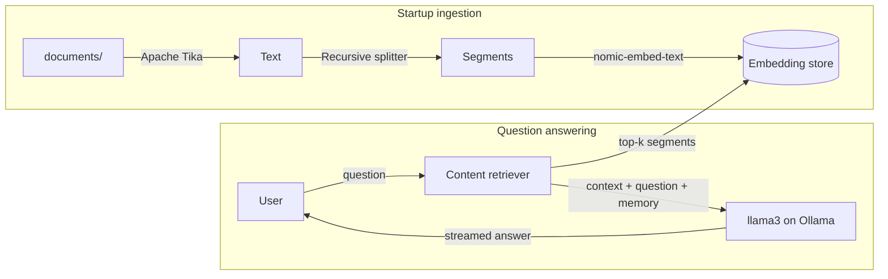

# Spring AI RAG with LangChain4j
*Study project*

A Spring Boot application that implements **Retrieval-Augmented Generation (RAG)** with [LangChain4j](https://docs.langchain4j.dev/) and **local LLMs running on [Ollama](https://ollama.com/)**. Documents are loaded at startup, split into segments, converted into embeddings and used as context to answer questions — through a REST API or a streaming chat page with conversation memory.

No external AI provider or API key is required: chat and embedding models run locally.

## Features

- **Document ingestion** — reads any file in the `documents/` folder with Apache Tika (PDF, DOCX, TXT, HTML...), splits it with a recursive token-based splitter and stores the embeddings.
- **Semantic retrieval** — `EmbeddingStoreContentRetriever` returns the most relevant segments (top 2, minimum score 0.6).
- **Declarative AI service** — `@AiService` interface with a system prompt, automatically wired to the chat model, the content retriever and the chat memory.
- **Conversation memory per chat** — `TokenWindowChatMemory` (1,000 tokens) isolated by `@MemoryId`.
- **Streaming responses** — tokens are streamed with Reactor (`Flux`) and Server-Sent Events to a simple HTML chat page.
- **Conversational retrieval chain** — a second approach using `ConversationalRetrievalChain` with a custom prompt template.

## Architecture



## Tech stack

| Layer | Technology |
|---|---|
| Language / framework | Java 21, Spring Boot 3.4, Spring WebFlux |
| AI orchestration | LangChain4j 0.36 (core, Spring Boot starter, Reactor, Ollama) |
| Models (local) | Ollama — `llama3` (chat) and `nomic-embed-text` (embeddings) |
| Document parsing | Apache Tika 3.1 |
| Tokenizer | HuggingFace tokenizer |
| Vector store | In-memory embedding store |

## Getting started

### Prerequisites

- Java 21
- Docker and Docker Compose

### 1. Start Ollama and pull the models

```bash
docker compose up -d
docker exec -it $(docker compose ps -q ollama) ollama pull llama3
docker exec -it $(docker compose ps -q ollama) ollama pull nomic-embed-text
```

### 2. Add your documents

Create a `documents/` folder in the project root and add the files you want to query:

```bash
mkdir -p documents
cp ~/my-files/*.pdf documents/
```

### 3. Run the application

```bash
./gradlew bootRun
```

The documents are ingested on startup. Ingestion progress is printed to the console.

## Usage

### Chat page (streaming + memory)

Open [http://localhost:8080/assistant.html](http://localhost:8080/assistant.html). Each chat keeps its own conversation history.

### REST API

| Method | Endpoint | Description |
|---|---|---|
| `POST` | `/ask` | Answers a question using the conversational retrieval chain |
| `POST` | `/v2/ask` | Returns only the retrieved segments (useful to inspect retrieval quality) |
| `POST` | `/api/assistant` | Registers a message for a chat `id` |
| `GET` | `/api/assistant/{id}` | Streams the answer for that message (SSE) |

Ask a question:

```bash
curl -X POST http://localhost:8080/ask \
  -H 'Content-Type: application/json' \
  -d '{ "question": "What is the refund policy?" }'
```

Inspect which segments were retrieved:

```bash
curl -X POST http://localhost:8080/v2/ask \
  -H 'Content-Type: application/json' \
  -d '{ "question": "What is the refund policy?" }'
```

## Configuration

| Setting | Value | Where |
|---|---|---|
| Ollama URL | `http://localhost:11434` | `AiConfig` |
| Segment size | 50 tokens, no overlap | `DocumentLoaderService` |
| Retrieval | top 2 results, min score 0.6 | `AiConfig` |
| Chat memory | 1,000 tokens per chat | `AiConfig` |

## Learnings

- Small segments (50 tokens) improve precision but can split ideas in half. Overlap and segment size are the first knobs to tune.
- The `/v2/ask` endpoint makes it easy to debug RAG: most bad answers come from bad retrieval, not from the model.
- `@AiService` removes most of the wiring code, while `ConversationalRetrievalChain` gives more control over the prompt.

## Next steps

- Replace the in-memory store with a persistent vector database (PGVector)
- Move model names and URLs to `application.yml`
- Add metadata (file name, page) to segments and return sources with each answer
- Compare this implementation with the Spring AI version: [spring-ai-ollama](https://github.com/egon89/spring-ai-ollama)
